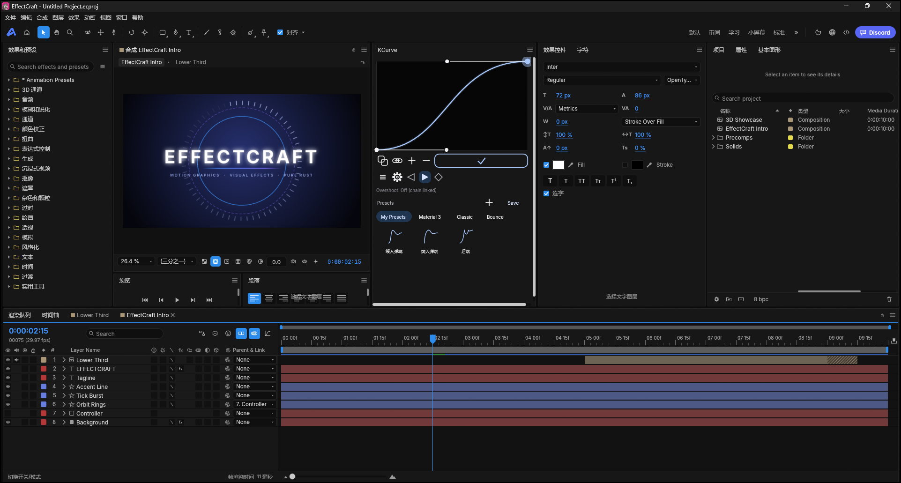
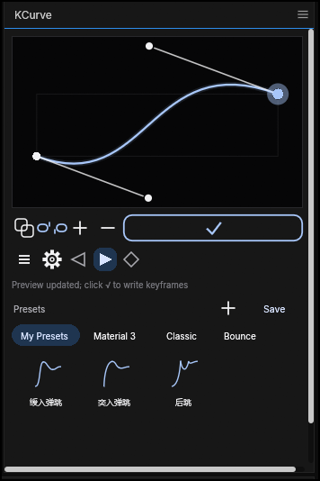

# KCurve

**EffectCraft 的 Flow / Kease 风格缓动曲线编辑器。**  
单文件 ScriptUI 脚本，固定停靠在 EffectCraft 面板中，支持单段曲线、多点关键帧、超出边界和预设库。

当前版本：**1.1.0**  
适用：**EffectCraft 0.18.0（0.13 的脚本 API 兼容）/ Windows**

KCurve 把关键帧的缓动从数字参数变成一条可以拖的曲线：

- **单段模式**：拖两个控制点和两根操纵杆，直接编辑 `cubic-bezier(x1, y1, x2, y2)`；
- **多点模式**：每个点就是一个关键帧，可以加段、删点、切换平滑/折断；
- **超出边界**：默认限制在 0–1，也可以断开链条，让曲线冲出 0–1，做出弹性、回弹和夸张的过冲；
- **实时写入**：打开齿轮后，拖曲线会立即写回选中的关键帧；
- **预设库**：Material 3 / Classic / 弹跳，全部可编辑，也可以保存自己的曲线；
- **中英双语**：下排第一个地球按钮切换 中文 / English；
- **固定停靠**：340×530 的固定面板，不占用额外的浮动窗口。

---

## 多点关键帧编辑

多点模式每个控制点都会变成一个真正的时间线关键帧：

1. 在单段曲线上点 **+**，曲线会在中间切开，变成 3 个点；
2. 选中中间的点，拖动它的操纵杆，只改变相邻的两段；
3. **−** 删除选中的中间点，首尾点不能删；
4. **平滑 / 折断**按钮切换当前点左右操纵杆是否联动；
5. 点 **√** 后，KCurve 会按首尾选中关键帧的时间范围，把所有点写成时间线关键帧。

截图里是一条多点曲线（「我的预设」组里是弹跳预设）：选中点才显示操纵杆，其他点只显示为圆点，
避免多点曲线变成一团乱线。

---

## 超出边界（Overshoot）

工具栏里的**链条图标**控制是否允许曲线超出 0–1：

- **链条连接**：值被限制在 0–1，适合普通缓动；
- **链条断开**：允许 `y < 0` 或 `y > 1`，可以做出弹簧、回弹、先冲过头再回来；
- 导入已经带 Overshoot 的曲线时，KCurve 会自动打开这个开关；
- 编辑器里会画出 **0–1 的边界框**，方便看出曲线越界了多少；
- 预设缩略图也会按实际范围缩放，不会把过冲曲线压平。

---

## 单段曲线

- 横轴是时间 0–1，纵轴是值 0–1；
- 拖**锚点**改关键帧的值/时间位置；
- 拖**操纵杆**改入/出切线；
- 编辑器只画曲线本身：没有顶部数值文本、没有网格，只有一条 1px 细边框；
- 面板不自己画背景，直接透出 EffectCraft 的界面底色（跟随主题和亮度）；
- 下方可以切换 **入侧 / 出侧 / 双侧** 写入；
- 选中关键帧后点 **√** 写入缓动；打开齿轮时拖动即实时写入。

> 截图里是从预设库载入的一条单段曲线；下方预设区可以直接点缩略图换曲线。

---

## 工具栏

分两行，平时**只显示图标**；鼠标移到某个控件上（或按下、或当前模式被选中）才出现底色。

上排：导入、链条（超出边界）、`+` / `−`、平滑（多点模式）、`√` 应用（占用整行剩下的宽度、勾居中，悬停时整条亮起）  
下排：三横线（设置）、齿轮（实时写入）、入 / 出 / 双侧（写入哪一侧；多点模式下变灰）

| 图标 | 功能 |
|---|---|
| 重叠方块 | 从选中的关键帧导入曲线 |
| 链条 | 允许 / 禁止超出 0–1 |
| + / − | 增加 / 删除关键帧点 |
| 斜线 | 平滑 / 折断操纵杆 |
| 圆角勾 | 应用当前曲线 |
| 三横线 | 设置：语言（中文 / English）、实时写入模式 |
| 齿轮 | 实时写入开关 |
| 入 / 出 / 双侧 | 写入哪一侧的缓动 |

应用按钮平时保留**蓝色描边**，悬停时叠加一层淡蓝底，按下时变成**实心蓝底 + 黑勾**。

### 设置菜单（1.0.13 起）

点下排的三横线按钮打开：

- **语言**：English / 中文（原来的地球按钮，带 ✓ 标记）；
- **实时写入模式**：「停止拖动后写入」开关（✓ = 开）：
  - **开**：拖动只更新预览，松手时才写入时间线；
  - **关**：随时写入（默认，和以前一样）。

应用按钮平时保留**蓝色描边**，悬停时叠加一层淡蓝底，按下时变成**实心蓝底 + 黑勾**。

---

## 预设库

- 组是横向排列的 chip，宽度随文字变化；
- 点击 chip 切换组，拖动 chip 可以调整顺序；
- 预设是正方形曲线缩略图，名称在下方；
- **保存**把当前曲线存进所选组（默认“我的预设”）；
- **所有预设都可编辑**：Material 3 / Classic / 弹跳 / 我的预设都一样，右键可以
  **用当前曲线更新**、重命名、复制、删除；
- **弹跳组**不是内置演示曲线：升级到 1.0.9 时会把当时「我的预设」里的内容**复制一份**进来
  （之后两边互不影响）；新装则没有这个组，自己保存/复制进去即可；
- 第一次升级到 1.0.5 时，内置的两组会一次性迁移成可编辑组（保留原来的曲线）；
- 组、预设和语言设置都保存在 `app.settings`，重启不丢。

---

## 安装

1. 关闭 EffectCraft；
2. 把 `KCurve.jsx` 放进：

   `C:\Users\<用户名>\AppData\Roaming\EffectCraft\Scripts\ScriptUI Panels`

3. 启动 EffectCraft；
4. 从 **Window ▸ KCurve.jsx** 打开。

详细步骤见 [INSTALL.md](INSTALL.md)。

### 关于尺寸

主版本是固定 **340×530** 的停靠面板。EffectCraft 0.13 / 0.17 都不会把停靠区实际尺寸告诉脚本
（脚本只能读到自己的 `preferredSize`，也没有接口读宿主的停靠矩形）：

- 停靠区更小：宿主会出现滚动条；
- 停靠区更大：保留固定画布；
- 不提供独立浮动版入口，避免两个窗口和双份快捷键。

---

## 文件

- `KCurve.jsx` — 主脚本
- `INSTALL.md` — 安装/升级
- `CHANGELOG.md` — 版本记录
- `releases/` — 历史版本快照
- `docs/README-TECHNICAL.md` — 实现细节和 EffectCraft ScriptUI 限制
- `docs/screenshots/` — README 截图

---

## 兼容与已知限制

- EffectCraft **0.17.0**（0.13 的脚本 API 兼容）；Windows 测试通过；
- 自定义画布没有局部重绘 API，所以是整块重绘；
- 没有鼠标捕获，快速拖出窗口可能丢失 `mousemove`；
- 没有滚轮事件，预设列表使用滚动条或拖动空白区域；
- 停靠面板不能响应宿主实际尺寸，固定 340×530 是折中。

---

## 贡献者

- **KOGGUA-EDIT** — 项目发起、设计、测试与发布
- **DeepSeek** — AI 编程助手，参与代码实现、文档与打包

## License

MIT。见 [LICENSE](LICENSE)。

