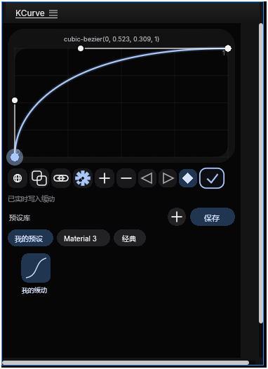
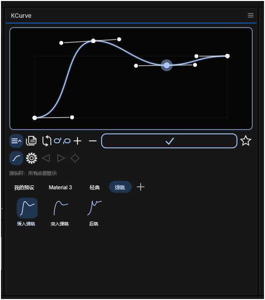

# KCurve 1.0.0

给 **EffectCraft 0.13.0** 用的、类似 AE Flow / Kease 的可视化曲线工具（ScriptUI 脚本，单文件）。

当前版本：**1.0.0**。主版本只通过 **Window ▸ KCurve.jsx** 提供固定 **340×530** 的停靠
编辑器，不再安装 File ▸ Scripts 的浮动版。工具图标和整体布局已压紧，功能按钮保持一行。
- **单段模式**：把一条 cubic-bezier 曲线写到选中关键帧的入/出缓动上。
- **多点模式**：每个点就是一个关键帧；点 √ 后按首尾选中关键帧的比例把点写成时间线上的关键帧。
- 带分组胶囊式预设库。



多点模式（每个点是一个关键帧，选中点才显示操纵杆）：



安装/升级说明见 [INSTALL.md](INSTALL.md)。

## 快速开始

```powershell
# 安装一次 ScriptUI 面板（Window 菜单里会出现 KCurve.jsx）
#   File ▸ Scripts ▸ Install ScriptUI Panel… → 选择 KCurve.jsx
#   之后每次从 Window ▸ KCurve.jsx 打开 340×530 的固定编辑器

# 开发/调试时也可以直接对着正在运行的 EffectCraft 跑
& 'C:\Program Files\EffectCraft\effectcraft-cli.exe' script 'D:\app edit\kcurve\KCurve.jsx' --bridge 9877
```

- 主版本是**停靠面板**，固定 preferredSize **340×530**，不拖边缩放。
- 因为 0.13 不把停靠区域实际尺寸告诉脚本，停靠区更小时宿主会出滚动条，
  更大时会留固定画布（详见 `KCURVE_NOTES.md` §6）。
- File ▸ Scripts 不再安装 KCurve；直接运行脚本只是开发调试入口，仍会开一个浮动窗口。

## 功能

### 1. 曲线编辑器（最上面）

- 二维平面：横轴时间 0–1，纵轴值 0–1。**1.0.3 起编辑器不再绘制顶部数值文本、
  网格和圆角框，1.0.4 起连 0/1 角标也去掉**；**1.0.8 起只剩 1px 细边框**（`P.outline`
  0.7 alpha），曲线区直接等于编辑器区域。这些每帧都要重建，曲线拖动整块重绘时是主要
  开销之一。单段/多点的数值信息改由状态栏和工具栏体现。
- 面板**不绘制自己的背景**：未绘制区域直接显示宿主面板底色，因此和 EffectCraft 界面
  完全一致（含主题与亮度）；预设区不再有整块黑底和遮罩黑条。
- **单段模式**：两个端点 + 贝塞尔拉杆，拖拉杆改缓动。
- **多点模式**：每个点就是一个关键帧，并且**有操纵杆**；为保持画面干净，只显示当前选中点的
  入/出拉杆，其他点只显示为圆点。每段曲线由前后点的拉杆直接决定。
- **允许超出边界**（链条图标）：链条**连接=关闭**（限制在 0–1），链条**断开=开启**，
  开启后可以拖出方框，视图自动扩展显示 overshoot。
- 实时预览：拖动时曲线和 canvas 立即重绘。

### 2. 从选中关键帧导入

- **选中 2 个相邻关键帧**时，点 **导入关键帧**（两个重叠方块图标）：读取 out/in 侧，
  按 Influence/Speed 反算 cubic-bezier 控制点。
- **选中 3 个及以上关键帧**时，同一按钮会把它们导入为**多点关键帧曲线**：
  每个选中键变成一个点，时间/值归一化到首尾键范围。
- 两个键、多组相邻键对时取所有相邻键对结果的平均值；状态栏会显示读取了几组。
  源码顶部有注释说明这个策略。
- 支持 Position（空间属性，沿运动路径的速度）和普通多维度属性（每维各自的速度）。
- Hold 侧、值不变的段会被跳过。

### 3. 预设库（下面）

- 组用**圆角矩形 chip** 表示，宽度随组名变化，横向排列并自动换行；点击 chip 切换组，
  拖动 chip 可以调整组的显示顺序。
- 当前组下方是**小正方形曲线预览 + 名称**的网格（参考 Flow）；点击预览加载曲线，
  右键可加载并应用、**用当前曲线更新**、重命名、复制、删除。
- **所有组都可编辑**（1.0.5 起）：Material 3 / 经典在首次载入时一次性迁移进可编辑的
  用户组（保留 id 和曲线，`STATE_VERSION = 3`），之后和自建组一样可以改名/删除/覆盖。
- 预设持久化在 `app.settings` 的 `KCurve/state`，即配置文件目录下的 `script_settings.json`。
  它是应用级数据，不随 `.ecproj` 项目文件走（和官方 Ease Presets 扩展一致）。
  没有桌面权限时脚本不能直接写文件，所以这是 0.13 唯一稳定的持久化方式。

### 4. 多点曲线

- 功能区的 **+** 把单段曲线用 de Casteljau 在中点切开：得到 3 个关键帧点，形状完全不变。
- 多点模式中的点可以左右拖（改时间）和上下拖（改值）；**选中点显示自己的入/出操纵杆**，
  拖杆改这一段曲线的切线，其他点不画拉杆。
- **−** 删除选中的中间点；首尾点不能删。删到只剩 2 个点会回到单段缓动模式。
- **平滑/折断**（S 形图标）：新建/切分出来的点默认**独立**，拖一侧时另一侧不会跟着甩；
  点 S 后该点左右拉杆才保持共线，再点回到折断。
- 多点模式应用时：以选中关键帧的**首尾键**为范围，每个点按 x 比例得到时间、
  按 y 比例得到首尾值之间的值；每段用该段的拉杆换算成入/出缓动。
  已存在的选中键会被替换，缺失的键会新增。

### 5. 实时修改开关

- **实时写入**（齿轮图标，空心=关，实心=开）关闭时：拖动只更新预览，点 **√** 才写入。
- 单段模式开启时：拖动拉杆/端点会立即写入当前选中关键帧。
- 多点模式（1.0.2 起）也会实时写入：拖动点/拉杆会按当前曲线重建时间线关键帧
  （1.0.12 起写入约 80ms 节流，mouseup 补最后一次），并保持时间线选中。
- 1.0.12 起，**实时写入时首尾之间的关键帧完全由编辑器决定**：删除点会立即删掉时间线上对应的键
  （包括 3 点→2 点回到单段模式时删掉中间键），范围内的其它键不再保留；实时写入关闭时仍然只改
  预览、点 **√** 才写，范围内的未选中键不动。
- 齿轮的缺口标记按面板重绘时间推进；0.17.0 的 GUI 会执行重复 `app.scheduleTask`，
  所以实时写入开启时它会转。关闭时计时器只在选中键数变化时触发重绘，空闲不刷。

### 6. 应用逻辑

- **单段模式**：入 / 出 / 入出 三种模式（左三角 / 右三角 / 菱形图标），默认“入出”。
- **多点模式**：每个点写成关键帧；每段用该段前后点的操纵杆换算成 ease
  （x1/x2 → influence，y 斜率 → 相对段平均速度）。
- 单段模式选中相邻关键帧对时，曲线第 k 段 → 第 k 个相邻键对（多出的键对复用最后一段）。
- 单个选中键时，出侧使用第一段，入侧使用最后一段（与官方 Ease Presets 的语义一致）。
- 写入 `KeyframeEase` 前会把关键帧时间按层 `stretch` 换算；空间属性用运动路径平均速度，
  普通属性每个维度各自缩放。Roving 键和 Hold 侧会跳过并在状态栏报数。
- 多点写入会**替换选中的键**（拓扑变化时先删后加），这样拖动点改变时间时不会留下重复键；
  当时间线已经和曲线点一一对应时只更新值/缓动，不删键（这样实时拖拽时选中不丢）。
  范围内未选中的键保持不动，状态栏会报告数量，曲线可能因此不完全贴合。
- 所有写入包在一个 `app.beginUndoGroup(...)` 里；实时拖动也是 mousedown→mouseup 一个撤销组。
- 注释里给了表达式方案作为二选一：本实现选择关键帧缓动，因为它不覆盖用户已有表达式，
  且已用 `verify/ease_math_probe.jsx` 数值验证可精确复现 cubic-bezier（误差约 1e-12）。

## 8. UI / 设计

- 工具栏固定**两行**（1.0.5 起），不再随窗口宽度自动换行：
  - 上排：导入、链条（超出边界）、`+` / `−`、平滑（多点）、`√` 应用；应用按钮从最后一个工具
    右侧一直延伸到行尾（1.0.6 起），勾在按钮内居中（1.0.7）；按钮常驻描边，悬停加淡蓝底，
    按下整条实心填色（1.0.9）；
  - 下排：三横线（设置）、齿轮（实时写入）、◁ / ▷ / ◆（入 / 出 / 入出）。写入边按钮**常驻**，
    多点模式下变灰（多点应用写两侧，选边不生效，点击会在状态栏说明）。
- **设置菜单**（1.0.13 起，点三横线）：语言 English / 中文（原地球按钮的功能）和
  「停止拖动后写入」开关。开关打开时 `applyLive()` 直接返回，拖动只在 `canvasMouseUp` 松手时
  写一次（`applyMultiCurve()` / `applyCurrent(false)`）；关闭则随时写入。开关保存在
  `app.settings` 的 `writeOnRelease`。
- 控件平时**只画图标/文字**，悬停、按下、选中的模式才画 chip 背景（1.0.5 起），
  悬停底色统一用 `P.highest`（1.0.9）；预设缩略图在未选中且未悬停时也不画方块底。
- **保存预设**对话框的「保存到组」默认选中面板当前所在的组（1.0.12），右键保存时不用再手动切换。
- 重绘节流 1.0.12 起为 16ms（约 60fps）；拖动期间曲线采样 32 → 20，松手后的最终重绘仍用 32。
- 英文翻译：`EN` 映射覆盖 `T()` 的固定文案，状态栏用 `TR(zh, en)`。1.1.0 补全设置菜单缺的三条
  键（Settings / Live write mode / Write on release）并润色多点、平滑/折断、实时写入等文案。
- 预设区参考 Flow：组是自适应宽度的圆角 chip、横向排列（一屏最多 5 个组，1.0.8 起）；
  预设是小正方形曲线预览，名称在下方。保存、新建组仍是胶囊按钮（悬停才显示底色）。
- 内置「弹跳」组（1.0.8）有 6 条多点预设，点是 Catmull-Rom 切线生成的平滑手柄，
  y 可以超过 0–1；载入时会自动打开链条断开，并把视图扩展到过冲范围。
- **重绘触发**（1.0.11 起）：`redraw()` 用 `window.layout.layout(true)` 触发整窗重绘，而不是
  `canvas.notify("onDraw")`。0.17/0.18 实测 notify 会让 onDraw 跑两遍（notify 自己一次 +
  宿主重绘再一次），layout 只跑一遍：40 次悬停的 onDraw 从 80 次降到 40 次
  （onDraw 约 4ms/次，相当于每帧脚本耗时 8ms → 4ms）。没有 `layout` 对象的宿主仍回退到 notify。
- 颜色跟随 EffectCraft 的 `appearance.theme`（dark / darker / light），在打开时和每次按下
  鼠标时重新读取；切主题后点一下面板即可刷新。文本由宿主用 EffectCraft 的 UI 字体绘制，
  脚本只控制字号/对齐（ScriptUI 的字体 family 在 0.13 里不会生效）。
- 支持最小 380×600、最大 2400×2000 的浮动窗口尺寸；曲线坐标按画布比例映射。
  停靠面板固定 340×530（宿主不把停靠区尺寸告诉脚本，见 KCURVE_NOTES §6）。

## 文件

| 路径 | 说明 |
|---|---|
| `KCurve.jsx` | 主脚本（单文件，安装到 ScriptUI Panels，当前 1.0.0） |
| `releases/KCurve-1.0.0.jsx` | 1.0.0 发布版快照 |
| `releases/KCurve-0.99.4.jsx` | 0.99.4 性能版快照 |
| `releases/KCurve-0.99.3.jsx` | 0.99.3 中英双语版快照 |
| `releases/KCurve-0.99.2.jsx` | 0.99.2 固定停靠版快照 |
| `releases/KCurve-0.99.1.jsx` | 0.99.1 固定停靠版快照 |
| `releases/KCurve-0.99.jsx` | 0.99 紧凑版快照 |
| `releases/KCurve-0.98.1.jsx` | 0.98.1 固定停靠版快照 |
| `releases/KCurve-0.98.jsx` | 0.98 版快照 |
| `releases/KCurve-0.97.jsx` | 0.97 版快照 |
| `releases/KCurve-0.96.jsx` | 0.96 版快照 |
| `releases/KCurve-0.95.jsx` | 0.95 版快照 |
| `releases/KCurve-0.94.jsx` | 0.94 版快照 |
| `releases/KCurve-0.93.jsx` | 0.93 版快照 |
| `releases/KCurve-0.92.jsx` | 0.92 版快照 |
| `releases/KCurve-0.91.jsx` | 0.91 版快照 |
| `releases/KCurve-0.90.jsx` | 0.90 版快照（基线） |
| `CHANGELOG.md` | 版本记录 |
| `README.md` | 本文件 |
| `LICENSE` | MIT |
| `docs/effectcraft/` | 官方脚本/控制协议文档、官方示例、ScriptUI 源码快照、可行性笔记 |
| `docs/effectcraft/KCURVE_NOTES.md` | 实测 API 速查、缓动换算公式、平台限制 |
| `docs/kcurve-panel.png` | 面板截图 |
| `verify/ease_math_probe.jsx` | 独立的缓动数学验证脚本（headless） |
| `verify/EASE_MATH.md` | 验证结果、公式、边界情况 |

## 已知限制

1. **停靠面板拿不到实际尺寸**：EffectCraft 0.13 的 `scriptui_view.rs::panel()` 在宿主侧
   按实际停靠区域布局，但脚本的 `onDraw` 仍按 preferredSize 生成 draw list。因此停靠版
   只能是固定 preferredSize 的完整编辑器（0.98.1 起）；官方安装版不再提供浮动窗口。
2. 开发调试用的浮动回退窗口只能拖**右 / 下 / 右下**边缘缩放；正式安装版是固定面板。
3. 没有鼠标滚轮事件支持：EffectCraft 0.13 只把 mousedown/move/up 等六种鼠标事件发给脚本。
   预设列表用右侧加宽的自定义滚动条拖动，或在列表空白处按住上下拖动来滚动。
4. `cubic-bezier` 的 x1=0 / x2=1 在 AE 缓动里不可精确表示（influence 0 会被拒绝）；
   写入时用 0.001/0.999 近似，误差约 2.4e-3（归一化），状态栏会提示。
5. 多点写入会替换**选中的**关键帧；如果首尾范围里还有未选中的键，它们不会被删除，
   曲线可能不贴合，状态栏会提示。
6. 多点模式的“实时写入”在 1.0.2 起会真正写时间线（40ms 节流），点 **✓** 只是补一次完整写入。
7. **没有局部/分区重绘**：0.17/0.18 实测，任何一次重绘都会重画整个窗口并重跑**所有**控件的
   `onDraw`（拆成多个自定义画布也不会减少总工作量）；没有脏矩形 API，脚本也无法创建图像缓存
   （`ScriptUI.newImage(w,h)` 报 TypeError）。只能减少每帧总工作量，不能只重绘某个区域。
8. **脚本定时器**：0.13.0 的 GUI 不回调重复 `app.scheduleTask`；0.17.0 起会执行。因此齿轮只在
   面板重绘时按时间旋转，组折叠是即时的；做不了真正的逐帧旋转/展开动画。
9. ScriptUI 不能写文件；预设只能存在 `app.settings`（应用级），不能导出 JSON 文件。
10. 内置预设组 1.0.5 起可编辑（重命名 / 复制 / 删除 / 用当前曲线更新）；旧设置会自动迁移。
11. 没有键盘快捷键、没有多选预设批量操作、没有撤销 UI 按钮（用 EffectCraft 自己的撤销）。

## 验证

```powershell
# 数学验证（headless，构建自己的测试 comp）
& 'C:\Program Files\EffectCraft\effectcraft-cli.exe' script 'D:\app edit\kcurve\verify\ease_math_probe.jsx' --empty --json
```

实测（live app + headless）：

- Opacity 0→100 @1s，写入 `cubic-bezier(0.42,0,0.58,1)` 后采样误差 < 1e-3，回读精确；
- Position（Spatial）单侧 ease 写入/回读一致；
- 单段转多点：切分后曲线形状不变（拉杆精确来自 de Casteljau）；删回 2 点恢复原 cubic；
- 多点模式：2 个选中键 + 3 个点 → 在 50% 时间新增 value=50 的关键帧；
  拖动中间点到 t=0.54/v=0.75 后再次应用 → 键移动到新时间，没有重复键；
- 3 个关键帧选中时点导入 → 3 个点，时间/值归一化正确；
- 主题 dark/light 切换、窗口拖边缘缩放（600→384→704）、预设保存/点击、分组滚动均通过。

## License

MIT。缓动换算思路来自 EffectCraft 官方 Ease Presets 扩展（MIT OR Apache-2.0，作者
EffectCraft contributors）；相关官方文档与源码快照保留其原始许可。


